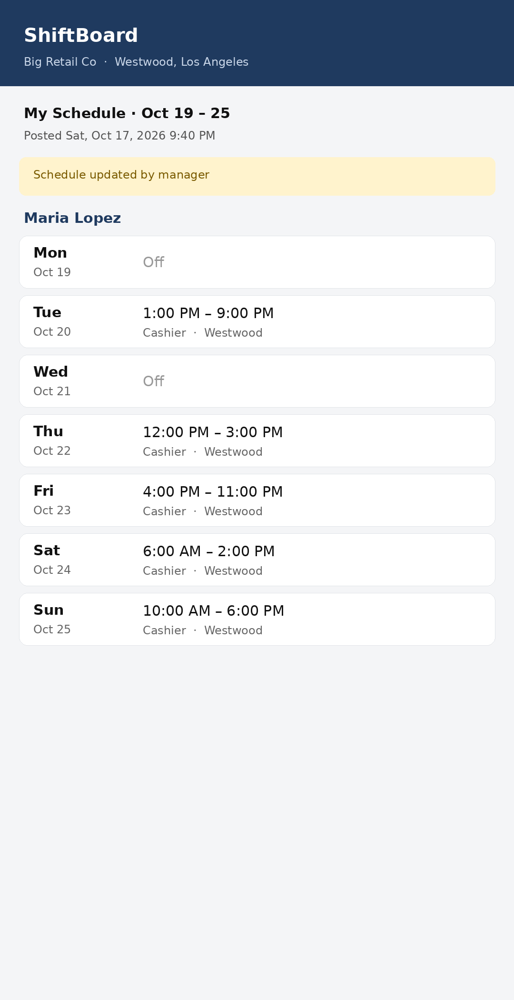

# ShiftReceipt


A worker-side agent for the City of Los Angeles Fair Work Week Ordinance (FWWO), running in ASI:One on Fetch.ai uAgents.

Built during LA Hacks AI Hackathon Oct 17-18 2026. All code in this repo was written during the event.

**Agent:** `shiftreceipt` &nbsp; **Address:** `agent1qffxdzuxgw6ad4k6dmlsfxd4h7ey26mgsfs0nt6lkgz8wv97z4w7wfexzpq`

## The problem

Large retailers in LA must post schedules 14 days before the work period starts. When they change a schedule
after that, the worker may be owed predictability pay: 1 hour of pay per change to the date, time or location,
1 hour for added hours, half pay for hours cut. A shift that starts less than 10 hours after the last one
earns a rest premium if it is worked. Workers rarely know this, and the evidence is a screenshot that changes
on their phone.

## What it does

1. The worker sends a screenshot of each schedule they get (or types it).
2. Gemini reads only that worker's shifts. Python checks every row; the worker fixes it and types CONFIRM.
3. ShiftReceipt compares the versions, asks one yes/no question per change (did you ask for it?), and prints a
   receipt: every line has an amount that may be owed, the rule and the City citation.
4. It shows a Notice to Cure preview on the official OWS form and tells the worker to check their paycheck first.

```mermaid
flowchart LR
  A[Screenshot or SCHEDULE text] --> B[extract.py: Gemini reads shifts only]
  B --> C[Worker: GOT date, EDIT, CONFIRM]
  C --> D[diff.py: versions to change events]
  D --> E[Q1..Qn: who asked for it?]
  E --> F[rules.py: integer cents, citations]
  F --> G[Receipt + notice preview]
  G -->|SEND id, same sender| H[notice.py: OWS PDF + email]
```

   Only if the worker types `SEND <id>` is the notice emailed to the manager address they gave.





Gemini never decides money, dates or rules: its output schema is shifts only. Amounts come from pure Python
(`rules.py`), in integer cents, tested against the City FAQ table.

## Rules applied

| Rule | When | Amount | Source |
| --- | --- | --- | --- |
| R3 change | Date, time or location changed after the 14-day deadline | 1 h of pay per change | OWS FWWO Rule 5; City FAQ table |
| R2 added | Hours added (> 15 min) or a new shift | 1 h of pay, plus 1 h per date/location change | OWS FWWO Rule 5 |
| R4 cut | Hours cut (15+ min) or shift cancelled | Half pay for hours not worked, plus 1 h per date/location change | OWS FWWO Rule 5 |
| R6 rest | Shift starts < 10 h after the last one | Extra half pay for the shift, only if worked | OWS FWWO Rule 6 |
| Exceptions | Worker asked for it, volunteered to cover, disciplinary cut | $0 | OWS FWWO Rule 5.1, LAMC 185.06.B |
| Deadline | 14 days before the start of the work period (Mon-Sun assumed) | | City FAQ 36, 50 |
| Cure | Employer has 15 calendar days from receipt of the notice | | City FAQ 65 |

Ambiguous changes (several shifts on one day, a move to another day with new hours, possible swaps) are
marked "needs review" with no amount, never guessed.

## Try it

In ASI:One, open "Chat with Agent" for `shiftreceipt` and send:

```
NAME Maria Lopez
RATE 20
EMPLOYER Big Retail Co
TITLE Cashier
STORE Westwood, Los Angeles
MANAGER you@example.com
COVER yes yes yes
```

Then the screenshots in `assets/demo` (or `SCHEDULE` blocks), `GOT 2026-10-03`, `CONFIRM`, and answer each `Q1 no`.
Demo result: $70.00 schedule-change pay, plus $80.00 rest premium if Saturday is worked.

## Run it

Needs Python 3.10+, a [Gemini API key](https://aistudio.google.com/apikey), and one way to send email:
a [Resend](https://resend.com) API key (HTTPS, works on networks that block mail ports; free plan delivers
to the account's own address) or a Gmail [app password](https://myaccount.google.com/apppasswords).

```
python3 -m venv .venv && .venv/bin/pip install -r requirements.txt
cp .env.example .env             # fill AGENT_SEED, GEMINI_API_KEY, RESEND_API_KEY (or SMTP_*)
.venv/bin/python agent.py        # open the Agent Inspector link it prints, Connect -> Mailbox
.venv/bin/python -m pytest -q    # offline tests, Gemini and SMTP mocked
```

| File | Role |
| --- | --- |
| agent.py | uAgent, Chat Protocol, conversation state machine |
| extract.py | Gemini reads the worker's shifts from a screenshot |
| diff.py, rules.py | schedule changes and the pay rules (pure Python, integer cents) |
| notice.py | fills the official OWS Notice to Cure PDF and emails it |
| parser.py, db.py, models.py | commands, per-sender SQLite state, data types |

## Privacy and safety

- Images are never stored, only their sha256. Logs hold message ids, never message text or emails.
- Every database query is filtered by sender. RESET works only for demo accounts.
- Email goes only to the manager address the worker set, only after `SEND <id>`, at most 2 per day.

## Limitations

Not checked: good-faith estimate, additional-hours offers, on-call shifts, force majeure, filing deadlines,
penalties. Work periods are assumed to run Monday to Sunday. Coverage is self-reported.

**Not legal advice.** ShiftReceipt prepares a draft and estimates what may be owed. Questions:
Office of Wage Standards, (844) 924-3752, wagesla.lacity.gov.
